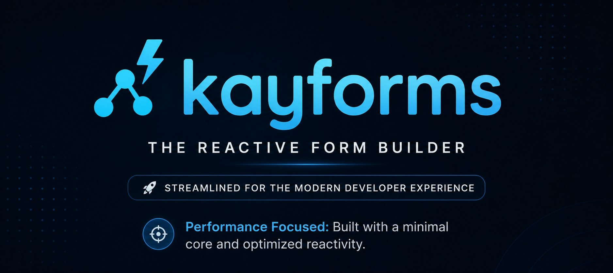
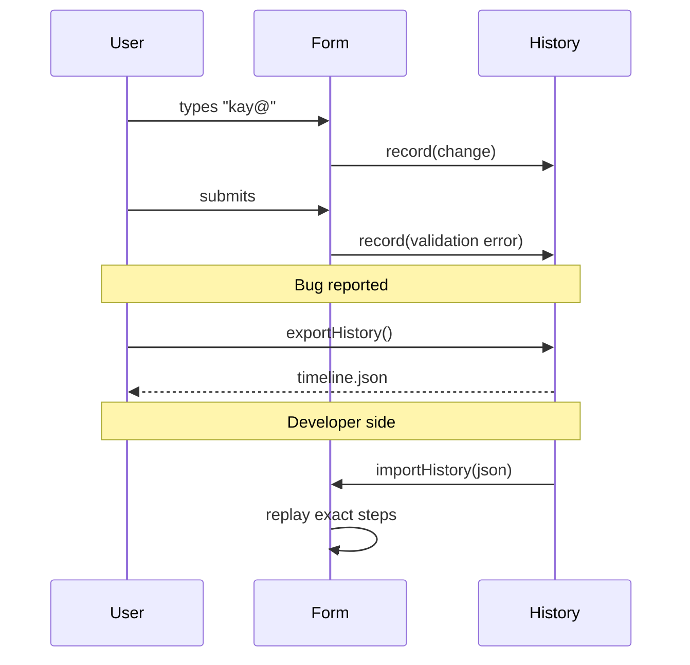
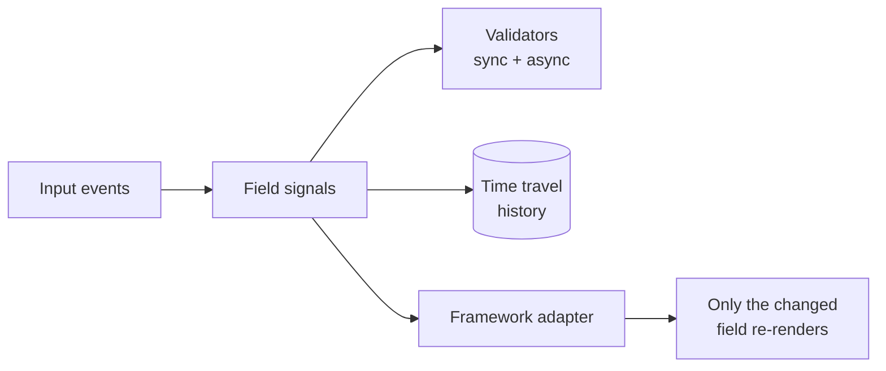

<div align="center">

```
██╗  ██╗ █████╗ ██╗   ██╗███████╗ ██████╗ ██████╗ ███╗   ███╗███████╗
██║ ██╔╝██╔══██╗╚██╗ ██╔╝██╔════╝██╔═══██╗██╔══██╗████╗ ████║██╔════╝
█████╔╝ ███████║ ╚████╔╝ █████╗  ██║   ██║██████╔╝██╔████╔██║███████╗
██╔═██╗ ██╔══██║  ╚██╔╝  ██╔══╝  ██║   ██║██╔══██╗██║╚██╔╝██║╚════██║
██║  ██╗██║  ██║   ██║   ██║     ╚██████╔╝██║  ██║██║ ╚═╝ ██║███████║
╚═╝  ╚═╝╚═╝  ╚═╝   ╚═╝   ╚═╝      ╚═════╝ ╚═╝  ╚═╝╚═╝     ╚═╝╚══════╝
```

### ⏰ Forms with superpowers. Tiny. Fast. **Travels through time.**

A framework-agnostic form library with fine-grained signals and built-in time travel debugging.

<br />

[](https://www.npmjs.com/package/@kayforms/core)
[](https://bundlephobia.com/package/@kayforms/core)
[](https://www.typescriptlang.org)
[](./LICENSE)
[](https://github.com/kelvinagyareyeboah/kayforms/stargazers)

<br />

[✨ Quick Start](#-quick-start) •
[⏳ Time Travel](#-time-travel-debugging) •
[📦 Frameworks](#-framework-support) •
[📖 API](#-api-reference) •
[🚀 Performance](#-performance) •
[🤝 Contributing](#-contributing)

<br />



</div>

---

## 🤔 Why KayForms?

Every form library asks you to pick a trade-off: fast but inflexible, flexible but slow, React-only, or too big.

KayForms aims for all four: **small, fast, framework-free, and debuggable.**

```text
Your form bugs? Rewind them. Literally.
```

| | |
|---|---|
| ⏳ **Time travel** | Record every keystroke, undo and redo, export a bug as JSON, replay it anywhere |
| 🌍 **Framework agnostic** | React, Vue, Solid, Svelte, Angular, or plain JS, all on one core |
| ⚡ **Fine-grained updates** | Only the field that changed re-renders, not the parent or siblings |
| 🔗 **Cross-form signals** | Share reactive state between separate forms |
| 🪶 **Tiny** | Small core, with everything else optional |

## 🆚 How it compares

| Feature | KayForms | React Hook Form | Formik |
|---|:---:|:---:|:---:|
| ⏳ Time travel debugging | ✅ | ❌ | ❌ |
| 🌍 Framework agnostic | ✅ | ❌ React only | ❌ React only |
| ⚡ Fine-grained re-renders | ✅ | ⚠️ Uncontrolled inputs only | ❌ |
| 🔗 Cross-form signals | ✅ | ❌ | ❌ |
| 📦 Bundle size (min+gzip) | **< 3 KB** | ~9 KB | ~12 KB |
| 🏎️ 1,000+ fields at 60fps | ✅ | ❌ | ❌ |

> [!NOTE]
> Competitor sizes change between releases. Check [Bundlephobia](https://bundlephobia.com) for current numbers.

## ⚡ Quick Start

### Install

```bash
# Core (required)
npm install @kayforms/core

# Pick your framework
npm install @kayforms/react   # or vue, solid, svelte, angular, vanilla
```

### Your first form

```tsx
import { createForm, field } from '@kayforms/react';
import { required, email, minLength } from '@kayforms/core';

function SignupForm() {
  const form = createForm({
    email:    field('', [required(), email()]),
    password: field('', [minLength(8)]),
  });

  return (
    <form onSubmit={form.handleSubmit}>
      <input {...form.email.bind} placeholder="Email" />
      {form.email.error && <span className="error">{form.email.error}</span>}

      <input {...form.password.bind} type="password" placeholder="Password" />
      {form.password.error && <span className="error">{form.password.error}</span>}

      <button type="submit" disabled={!form.isValid()}>
        Sign up
      </button>
    </form>
  );
}
```

No `register()`. No `watch()`. No controlled-vs-uncontrolled decisions.

## ⏳ Time Travel Debugging

> *"It's like a dashcam for your forms."*

KayForms records every keystroke, every validation error, and every async call on a timeline. From there you can:

- ⏪ **Rewind** any number of steps
- 📤 **Export** the full timeline as JSON
- 📥 **Import** it on any machine
- 🔁 **Replay** the exact bug your user saw, on your laptop



### Enable it

```tsx
import { createForm, field, enableTimeTravel } from '@kayforms/react';

function DebuggableForm() {
  const form = createForm({
    email:    field(''),
    password: field(''),
  });

  enableTimeTravel(form, { maxHistory: 100 });

  return (
    <div>
      <form onSubmit={form.handleSubmit}>
        <input {...form.email.bind} placeholder="Email" />
        <input {...form.password.bind} type="password" placeholder="Password" />
        <button type="submit">Submit</button>
      </form>

      <div className="debug-controls">
        <button onClick={() => form.undo()}>⏪ Undo</button>
        <button onClick={() => form.redo()}>⏩ Redo</button>
        <button onClick={() => console.log(form.exportHistory())}>📤 Export</button>
      </div>
    </div>
  );
}
```

### 🐛 Report a bug with proof

```js
// Attach this JSON to your GitHub issue and we can replay it exactly
const timeline = form.exportHistory();
console.log(JSON.stringify(timeline, null, 2));
```

> [!WARNING]
> Timelines record what users type, including passwords and personal data. Strip or mask sensitive fields before sharing an export, and keep time travel off in production unless you need it.

## 📦 Framework Support

KayForms runs anywhere JavaScript runs.

| Framework | Package | Status |
|---|---|:---:|
| ⚛️ React | `@kayforms/react` | ✅ Stable |
| 💚 Vue | `@kayforms/vue` | ✅ Stable |
| 🔥 Solid | `@kayforms/solid` | ✅ Stable |
| 🔶 Svelte | `@kayforms/svelte` | ✅ Stable |
| 🔴 Angular | `@kayforms/angular` | ✅ Stable |
| 🟨 Vanilla | `@kayforms/vanilla` | ✅ Stable |

```bash
npm install @kayforms/core          # always required
npm install @kayforms/[framework]   # your choice
npm install @kayforms/devtools      # optional Chrome DevTools panel
```

## 🧠 Architecture



Each field is its own signal. When one changes, only the components reading that field update. Nothing else re-renders.

## 📖 API Reference

<details open>
<summary><b>🧱 Core: createForm</b></summary>

```ts
import { createForm, field, fieldGroup, fieldArray } from '@kayforms/core';

const form = createForm(schema, options);

form.getValue()            // → entire form state
form.setValue(data)        // ← set entire form state
form.reset()               // ← reset to initial values
form.validate()            // → run all validators
form.isValid()             // → boolean
form.subscribe(callback)   // → unsubscribe function
```

</details>

<details>
<summary><b>⏳ Time travel</b></summary>

```ts
enableTimeTravel(form, { maxHistory: 100 });

form.undo()                // step back
form.redo()                // step forward
form.jumpTo(index)         // jump to a point in history
form.getHistory()          // → full history array
form.clearHistory()        // wipe the timeline
form.exportHistory()       // → JSON string
form.importHistory(json)   // ← load from JSON
```

</details>

<details>
<summary><b>✅ Built-in validators</b></summary>

```ts
import { required, email, minLength, maxLength, pattern, match } from '@kayforms/core';

const form = createForm({
  username: field('', [required()]),
  email:    field('', [required(), email()]),
  password: field('', [required(), minLength(8), maxLength(100)]),
  confirm:  field('', [match('password')]),
});
```

</details>

<details>
<summary><b>🌐 Custom async validators</b></summary>

A validator returns an error message, or `null` when the value is valid.

```ts
const uniqueUsername = async (value: string) => {
  const res = await fetch(`/api/users/check/${value}`);
  const { exists } = await res.json();
  return exists ? 'Username is already taken' : null;
};

const form = createForm({
  username: field('', [required(), uniqueUsername]),
});
```

</details>

## 🚀 Performance

Frames per second while typing, by form size.

| Fields | KayForms | React Hook Form | Formik |
|---|:---:|:---:|:---:|
| 10 | **60** | 60 | 55 |
| 100 | **60** | 58 | 42 |
| 500 | **60** | 52 | 28 |
| 1,000+ | **60** | 45 | 15 |

<sub>MacBook Pro M1 · Chrome 120 · average of 10 runs. Reproduce them yourself in [`/benchmarks`](./benchmarks).</sub>

## 🗺️ Roadmap

- [x] Core with fine-grained signals
- [x] Adapters for React, Vue, Solid, Svelte, Angular, and Vanilla
- [x] Time travel debugging
- [x] Async validators
- [ ] Chrome DevTools panel
- [ ] Schema validation adapters (Zod, Valibot)
- [ ] Field-level persistence (localStorage)
- [ ] Visual timeline scrubber

## 🤝 Contributing

Open source, and PRs are welcome.

```bash
git clone https://github.com/kelvinagyareyeboah/kayforms.git
cd kayforms
npm install
npm run dev    # start dev server
npm run test   # run the test suite
```

- 🐛 **Found a bug?** Export your timeline JSON and [open an issue](https://github.com/kelvinagyareyeboah/kayforms/issues). We can replay it exactly.
- 💡 **Have an idea?** Open a discussion before a PR so we can align first.
- 📝 **Docs unclear?** Docs PRs are always welcome, no issue needed.
- ⭐ **Just want to help?** Star the repo. It matters more than you'd think.

## 📄 License

[MIT](./LICENSE) © [Kelvin Agyare-Yeboah](https://github.com/kelvinagyareyeboah). Use it, modify it, ship it, and keep the copyright notice.

<div align="center">

<br />

**Built for developers tired of fighting their form library.** 🛠️

If KayForms made your life easier, [give it a star](https://github.com/kelvinagyareyeboah/kayforms/stargazers) ⭐

</div>
